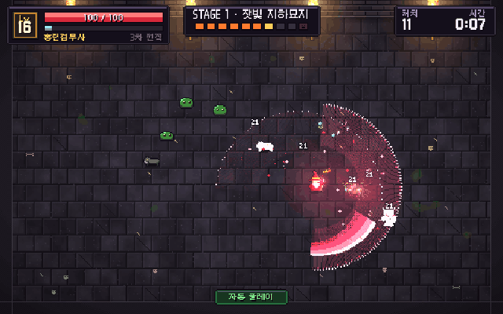

# 마법사 키우기

**몰려오는 몬스터를 버티며 전직으로 강해지는 탑다운 픽셀 액션 로그라이트.**



방향키(WASD)로 움직이면 가까운 적을 자동으로 공격합니다. 마우스·터치로 끌어서 움직일 수도 있고, Esc나 P는 일시정지입니다.

- 스테이지 3개 × 웨이브 10개, 스테이지마다 마지막에 보스가 나옵니다. 3스테이지 보스를 쓰러뜨리면 클리어, 이어서 무한 모드입니다.
- 레벨 4·10·16에 전직합니다(1→3→9→27, 모두 39종). 그 밖의 레벨업은 체력·공격력이 자동으로 오릅니다.
- 판이 끝나면 불씨 결정으로 기본 능력 5종을 올립니다. 기록과 전직 도감은 이 브라우저(`localStorage`)에 저장됩니다.

## 직접 실행

빌드 없이 브라우저에서 돕니다. ES 모듈을 쓰므로 파일을 직접 열지 말고 로컬 서버로 띄웁니다.

```sh
git clone https://github.com/tinkerer0/wizard_game.git
cd wizard_game
python3 -m http.server 8765   # http://localhost:8765 열기
```

테스트용 주소 옵션·코드 구조·밸런스 확인 방법은 [docs/DEVELOPMENT.md](docs/DEVELOPMENT.md)에 있습니다.

## Feedback

제가 이런 분야를 접한 지 얼마 안 돼서 부족한 점이 많습니다. 고칠 점이나 알려주실 내용이 있다면 issue나 PR로 남겨주시면 너무 감사하겠습니다.

## License

코드는 [MIT](LICENSE)입니다. 함께 들어 있는 것:

- [pixelfx](https://github.com/patch-gg/pixelfx) — MIT (`vendor/pixelfx/LICENSE`, `NOTICE.md`)
- [Galmuri](https://github.com/quiple/galmuri) 픽셀 폰트 — SIL OFL 1.1 (`assets/fonts/OFL.txt`)
